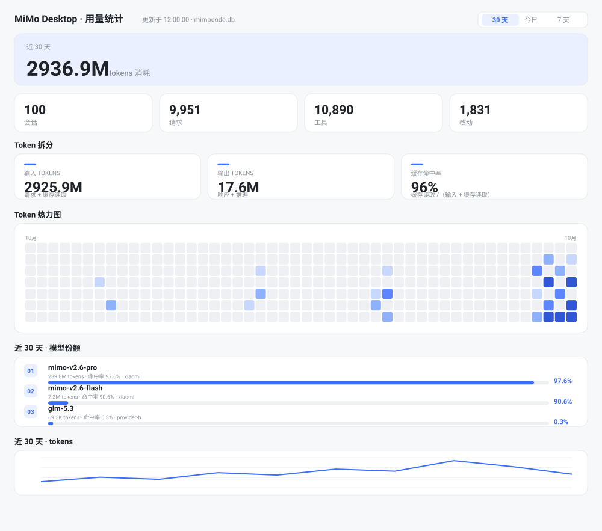
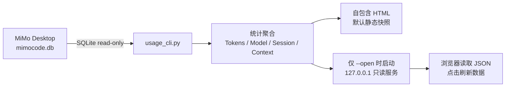
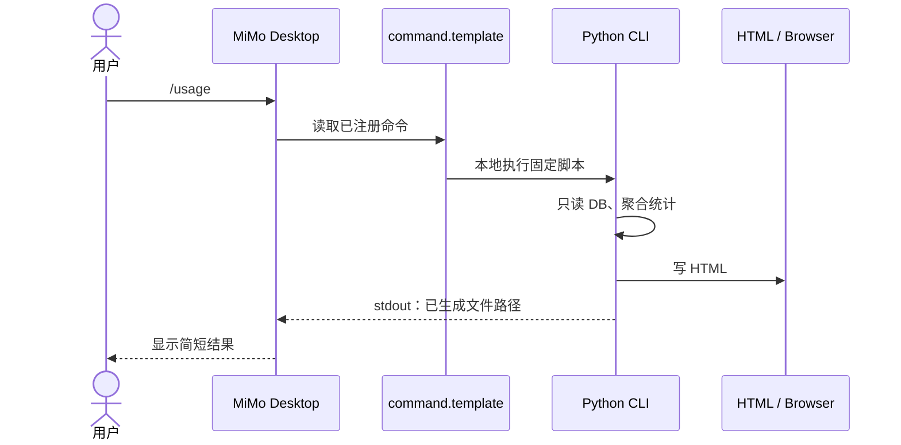

# MiMo Usage Dashboard

> 看清明 MiMo Desktop 的 token 都花在哪了。

[](https://github.com/Martin-soaring-dev/mimo-usage-dashboard/releases)
[](#%E5%AE%89%E8%A3%85)
[](https://mimo.xiaomi.com/coder)
[](#%E5%AE%89%E8%A3%85)
[](./LICENSE)

简体中文 · [English](./README.en.md) · **[🚀 快速上手](./docs/quick-start.md)** · [v0.2.1 Release](https://github.com/Martin-soaring-dev/mimo-usage-dashboard/releases/tag/v0.2.1)

给 **MiMo Desktop**（内置 MiMoCode 引擎，OpenCode 分支）做**本机**用量统计：
一个**本地命令行**，把用量渲染成 **HTML 看板**。

**零 AI 参与、不联网上传。** `/usage` 默认出静态快照；`/usage-open` 可选启动仅监听 `127.0.0.1` 的只读刷新服务。

```
/usage      ─►  引擎本地执行 python usage_cli.py
            ─►  只读 mimocode.db → 聚合 → 写静态 HTML 快照（默认用户数据目录）
/usage-open ─►  同上，另起 loopback 只读刷新服务并打开浏览器
            ─►  AI 只把这行结果原样转述
```

### Token 页的区块顺序

1. **Hero 大卡** — 范围内 tokens 总量 + 最近 30 天迷你趋势
2. **8 个统计小卡**（2×4）— 输入 / 输出 / 缓存读取 / 缓存命中率 / 请求数 / 工具调用 / 会话数 / 平均每次请求
3. **Token 热力图** — 最近 12 个月 × 每日 tokens，GitHub 风格 4 档分位配色（**不受 `--days` 限制**，始终看全年）
4. **按模型的调用情况** — 每个模型一行：token 总量、缓存命中率、请求/工具数；条长 = 该模型 token / 窗口内全部模型 token，条内浅色段 = 该模型缓存读取

配色语义互不混用：

| 区块 | 配色 |
|---|---|
| 模型份额条 | 深蓝=该模型 token 份额；**浅蓝段=该模型缓存读取**（与份额同分母） |
| 上下文构成条 | 浅蓝=缓存读取，蓝=新输入，紫=推理，绿=输出 |

- **Session 用量**：会话总数、累计 tokens、改动行 / 文件数、最近会话明细
- **上下文占用**：当前会话上下文 tokens、构成（缓存读取 / 新输入 / 推理 / 输出）、模型、工作目录


## 界面预览（合成数据示意）



> 这张图是仓库已有的 SVG 合成数据预览，**不是**真实用户数据或实机验收截图。v0.2.1 已在 Windows MiMo Desktop 26.1014.65535.94 完成原生安装、/usage、/usage-open 和卸载验收；原始验收截图未作为公开资产上传。

**[🚀 从零安装、逐步使用、遇到问题如何处理：快速上手](./docs/quick-start.md)**

| 你的目标 | 正确操作 | 预期结果 |
|---|---|---|
| 第一次装好 | `npm install -g mimo-usage-dashboard@0.2.1` → `mimo-usage-dashboard install` → 重启 MiMo，新建会话 | 命令面板出现 `/usage` 和 `/usage-open` |
| 一次性查看用量 | `/usage` | 生成自包含 HTML 静态快照，返回路径 |
| 需要按按钮刷新 | `/usage-open` | 启动按需本地只读服务、打开实时浏览器 |
| 指定模型/时间窗、输出位置 | 本地终端运行 `python usage_cli.py token --days 7` 等 | 按参数生成独立报告；**斜杠命令不解析后缀参数** |
| 确认安装/卸载 | `mimo-usage-dashboard doctor` / `uninstall` | 诊断配置、注销命令并安全删除项目拥有的文件 |

## 设计原理与实现

### 需求与边界

MiMo Desktop 本身会将本机用量记录写入 SQLite 数据库。项目解决的是“如何从这些记录看清 token 构成、缓存命中、模型分布、会话活动和上下文占用”，**不是**推算套餐余量、读取模型服务端账单或上传你的聊天记录。统计始终在本机由 Python 程序确定计算，不让语言模型猜测数字；浏览器只负责展示已经聚合的数据。

技术目标有三个：**可解释**（所有指标有口径）、**离线优先**（静态 HTML 可自行打开）、**低侵入**（只读 DB、按需实时服务、可逆的命令注册）。

### 数据管线（逻辑图）



- **数据库读取**：以 SQLite `mode=ro` 读取 `session`、`message`、`part` 等表；数据库锁定或并发写入时使用临时只读快照路径，避免修改用户原数据库。
- **计算层**：在本机按时间窗、模型和会话聚合 Token 与相关字段；上下文占用优先来自最新 step-finish 记录，不把累计 Tokens 误写成单轮上下文。
- **展示层**：`usage_cli.py` 直接渲染内联样式、脚本和数据的独立 HTML；静态网页打开后无需 CDN/服务器连接。
- **实时层**：`/usage-open` 启动或复用仅监听 `127.0.0.1` 的本地服务，随机令牌放在路径里，并校验 Host/Origin。API 返回只读聚合结果，不公开任意文件系统访问接口。关闭浏览器不一定马上关闭服务，服务可在空闲时间到期退出。

### 斜杠命令为什么不用 AI 自己生成 HTML？

仓库对目标客户端的 [MiMoCode 引擎机制实证](./docs/architecture.md) 表明：普通工具插件不能随意往 Desktop 右侧边栏挂自定义页面，AI 在聊天内流式生成大型 HTML 卡片则需要大量输出。项目采用 MiMo 的 `command.template` 固定本地 shell 替换机制：



因此**是本地程序计算，而不是模型输出一套貌似正确的统计数值**。但需说准确：MiMo 引擎仍然可能把 shell 的 stdout 插回发给模型的消息，模型承担结果转述；这里的“零 AI 参与”特指**统计与 HTML 生成阶段**，不是声称消息完全不经过模型。

`/usage`、`/usage-open` 的模板故意不拼接 `$ARGUMENTS`。所以在聊天里输入 `/usage token --days 7` **不会**安全地转化成筛选请求；高级参数应直接交给终端的 `usage_cli.py`。

### 代码组成与职责

| 文件 | 实际职责 |
|---|---|
| `bin/mimo-usage.js` | 零第三方依赖 npm 入口，寻找 Python ≥ 3.10、映射 install / upgrade / doctor / report / open / uninstall |
| `install.ps1` | Windows 安装薄壳：校验解释器，把参数交给事务引擎 |
| `installer.py` | 安装唯一事实来源：Preflight → Backup → Stage → Validate → Apply → Verify、回滚、升级和卸载 |
| `register_command.py` | 对 JSONC 进行局部文本编辑，只注册/注销本项目拥有的 command，保留无关注释、BOM、CRLF 与字段 |
| `usage_cli.py` | SQLite 只读查询、模型/会话聚合、HTML 渲染、仅本机的按需实时服务 |
| `test/` | 合成库、安装器、CLI、命令模板、DOM/CDP 浏览器和回滚机制回归 |

### 安装器为什么能安全升级和卸载？

安装不是“复制两个 .py 文件后就结束”。`installer.py` 的六阶段事务先做**前置条件检查与归属识别**，再备份、阶段化准备、校验、应用并验证；失败时尽可能撤销本次操作。`install-manifest.json` 记录被项目管理的文件哈希和版本，因此卸载默认只移除“可证明属于本项目且未被用户修改”的文件，保留无关命令、项目外文件、历史报告、数据库和备份。若文件归属不明或 JSONC 无法安全解析，安装器拒绝静默覆盖；不要为了省事直接使用 `--force`。

### 统计指标的准确含义

| 卡片/指标 | 本项目口径 | 常见误解 |
|---|---|---|
| Tokens 总量 | 输入 Tokens + 输出 Tokens | 不等于最终付费金额 |
| 输入 Tokens | 新输入 + 缓存读取 | 不等于“本次新发给模型的文本” |
| 输出 Tokens | 文本输出 + 推理 Tokens | 不等于只计算屏幕可见文字 |
| 缓存命中率 | cache.read / (tokens.input + cache.read) | 不是对全部 tokens 求比例 |
| 模型份额 | 各模型 Tokens 占所选窗口的比例 | 不等于不同定价模型的费用比例 |
| 上下文使用量 | 会话最新 step-finish 的 tokens.total，必要时回退最新 assistant 消息 | 不等于会话历史累计 token 总数 |
| 上下文上限 | 配置中对应 providerID + modelID 的 limit.context，或本次显式值 | 不等于服务端永远固定的真实窗口 |

热力图显示的是近一年的按日活跃度，**不随** `--days 7` 改成只有七天。模型条的长度表示该模型对窗口内 Token 总量的份额，浅色段才是缓存读取占比，颜色不能混用。

### 会话定格：为什么最近活跃会话不一定是当前聊天？

当使用 `/usage-open` 打开新浏览器标签页时，应用会将“**第一次加载时最近活跃的会话**”定格到这个标签页，之后刷新不悄悄换到新会话。这修复了旧行为中浏览器标签页随最近会话漂移的风险，但它**不是**“命令在哪个聊天发送就必然绑定哪个聊天”——当前斜杠命令机制拿不到该会话身份。页面可切换“会话用量 / 全局用量”；需要强制指定某个会话，请在 CLI 使用 `--session`。详见 [快速上手 `4](./docs/quick-start.md#4-实时模式浏览器中刷新)。

### 验证边界、安全与风险

- 已实测：Windows 11、MiMo Desktop 26.1014.65535.94；真实客户端原生加载、静态报告、实时刷新、卸载后命令消失均完成。其他平台没有同等级客户端验证。
- 静态报告默认不监听端口；实时服务限制在 loopback，报告内容仍属于个人敏感数据，勿在公开截图中暴露随机 URL token 或私人会话路径。
- 已知 P2：[#35 启动服务偶发失败](https://github.com/Martin-soaring-dev/mimo-usage-dashboard/issues/35)（可能退化为静态报告但终端提示不足）、[#39 特殊隐藏目录路径的 Markdown 转义](https://github.com/Martin-soaring-dev/mimo-usage-dashboard/issues/39)（`\.` 反斜杠可能丢失，导致链接无效）。两者在 v0.2.1 **未宣称已修复**。
- 可靠性证据、npm/GitHub 分发哈希与发布边界见 [v0.2.1 发布报告](./docs/releases/v0.2.1-release-report.md)。实操故障表请看 [快速上手](./docs/quick-start.md#7-我这样做会有什么响应故障速查)。

## 为什么是「本地命令 + 静态网页」

两条来自 MiMo 应用本体的硬约束（详见 [`docs/architecture.md`](./docs/architecture.md)）：

1. **插件 API 只有服务端能力**。`@mimo-ai/plugin` 只能注册 agent 工具，
   **不能往应用界面注入自定义页面**（右侧面板菜单是编译进 bundle 的常量）。
2. **对话内的 `sci-widget` 卡片必须由 AI 逐字输出 HTML**。只要卡片 HTML 由 AI 流式生成，
   正文里就会经历一段「正在生成交互演示…」的等待，还消耗大量 token。

于是改走**第三条路**：让 MiMo 引擎的 `command` 机制**先在本地执行脚本**。

引擎内置 shell 替换语法（`src/config/markdown.ts` 的 `SHELL_REGEX`）：
写在 `command.template` 里的反引号命令会在**本地真实执行**，stdout 插回文本 ——
这就是 qwen code `/update` 那种**确定性本地函数**。

| | 旧方案（v0.1.x） | 新方案（v0.2+） |
|---|---|---|
| `/usage` 机制 | 技能 → AI 理解 → AI 调工具 → AI 贴结果 | `command` + 本地 shell 替换 → **本地执行** |
| AI 参与 | 必须（两跳） | **仅复述一行输出** |
| 服务 | 常驻 `127.0.0.1:8790` | **默认无**；`/usage-open` 按需起 loopback 只读服务 |
| 对话内卡片 | `sci-widget`（AI 逐字输出 HTML） | 静态 HTML 文件 |
| 运行时 | Node ≥ 22 | **Python ≥ 3.10（仅标准库）** |

## 安装

### 方式 A：npm（推荐）

```powershell
npm install -g mimo-usage-dashboard
mimo-usage-dashboard install
```

**这两条命令是两件事，别只跑第一条**：`npm install -g` 只是把这个 CLI 放到 PATH 上（不会碰你的任何配置）；`mimo-usage-dashboard install` 才真正把看板装进 MiMo。装完**彻底重启 MiMo Desktop**，再**新开一个会话**，然后输入 `/usage`。

命令一览：

| 命令 | 作用 |
|---|---|
| `mimo-usage-dashboard install` | 安装（重复安装/覆盖安装会走同一条安全路径；文件与命令都已是最新时不重装任何文件、不新建备份、不跑 Backup/Stage/Apply/Verify——唯一可能的写入是 manifest：其记录的版本落后时才更新这个元数据文件） |
| `mimo-usage-dashboard upgrade` | 升级到当前 CLI 自带的版本；**拒绝静默降级**（除非 `--allow-downgrade`） |
| `mimo-usage-dashboard uninstall` | 注销命令 + 删除"能证明属于本项目且未被你改过"的文件；报告/数据库/备份全保留 |
| `mimo-usage-dashboard doctor` | 只读体检：Python、配置、注册、安装状态、运行实例、残留。退出码 0 健康 / 1 警告 / 2 有问题 |
| `mimo-usage-dashboard where` | 打印全部关键路径（排错用） |
| `mimo-usage-dashboard version` | CLI 版本 + 已安装版本 |
| `mimo-usage-dashboard report` | 生成静态快照并打印路径（等价 `/usage`） |
| `mimo-usage-dashboard open` | 打开实时看板（等价 `/usage-open`） |

公共开关：`--config <mimocode.jsonc>`、`--install-dir <dir>`、`--python <python.exe>`。**不需要 Python 之外的任何额外依赖**；CLI 本身零 npm 依赖。

要试一下而不装到全局：`npx mimo-usage-dashboard doctor`。

卸载：

```powershell
mimo-usage-dashboard uninstall              # 注销 + 删除本项目文件（保留你的报告/数据库/备份）
mimo-usage-dashboard uninstall --keep-files # 只注销，文件全留
mimo-usage-dashboard uninstall --purge-backups   # 额外清理备份（会先列出再删）
```

### 方式 B：一键脚本（Windows，无需 Node）

已经 clone 了仓库、机器上没有 Node 时用这条：

```powershell
git clone https://github.com/Martin-soaring-dev/mimo-usage-dashboard
cd mimo-usage-dashboard
powershell -ExecutionPolicy Bypass -File install.ps1
```

如果本地 AI 已确认实际生效的配置文件不在默认位置，可显式指定路径：

```powershell
powershell -ExecutionPolicy Bypass -File install.ps1 -Config "C:\实际路径\mimocode.jsonc" -Python "C:\实际路径\python.exe"
```

也可用 `-InstallDir` 指定脚本安装目录。实机路径发现、安装提示词和验收流程见 [Windows 实机验收指南](./docs/windows-live-test-prompts.md)。

### 安装器是"可靠升级器"，不是一次性复制

（`install.ps1` 只是 Windows 上的解释器探测 + 转发壳；事务逻辑在 `installer.py` 里，只有一份实现。）

安装按 **Preflight → Backup → Stage → Validate → Apply → Verify** 六个阶段执行，任何阶段失败都会回滚本次改动：

- **安装前检测**：目标目录是否已有本项目文件、是否存在 `install-manifest.json`、是否有本项目服务在运行。发现旧安装会进入 `upgrade`（有 manifest）或 `adopt`（无 manifest 但有本项目标记）模式，**不会直接覆盖**。
- **`install-manifest.json`**：记录产品名、版本、安装时间与两个脚本的 sha256，用来区分**本项目文件**与**你的文件**。没有 manifest 时只依据文件内的归属标记判断，**绝不按文件名认领**。
- **归属不明 / 已被修改的文件拒绝覆盖**：此时安装会中止并列出原因。确认那些文件确实由本项目的旧版本产生后，再加 `-Force` 重跑（覆盖前仍会备份）。
- **运行中的本项目服务**：身份校验 = token 合法 + 端口合法 + loopback + `GET /{token}/api/ping` 返回本项目身份标识。三态全过才用本项目协议发 `shutdown` 并等待退出（关闭失败即中止）；**可访问但不是本项目服务**则中止、不碰它；**不可达/无效**则视为陈旧状态**继续安装**——由更早版本启动、还没有 `/api/ping` 路由的服务就属于这一类（探测会拿到 404），安装器**不会**保证优雅关闭它，该进程需你手动关闭或等其空闲超时自行退出。**所有分支都绝不 taskkill、绝不按端口或未知 PID 杀进程。** 探测走常量时间的 `/api/ping`（不读数据库），因为 `/api/report` 每次请求都做全量聚合，大库上会超过探测超时。
- **备份**：本次会被覆盖的文件复制到 `<InstallDir>\.mimo-usage-backups\<时间戳>\`，配置本身另有带时间戳的 .bak。**备份、HTML 报告、数据库、未知文件一律不会自动删除。**
- **`-RemoveLegacy`**：只在显式指定时清理旧版遗留文件；`skills\usage` 这类**非空目录**还要再加 `-Force` 才会递归删除（默认只列出内容）。
- **`-PreflightOnly`**：只做检测并打印结论，**不安装任何文件、不改配置**；但会创建目标安装目录，并可能用本项目协议关闭正在运行的本项目服务（监听者不是本项目服务就直接中止；不可达/无效按陈旧状态处理；绝不按端口或 PID 强杀）。
- **已是最新时不重装、不新建备份**：程序文件与命令注册都与本次内容一致时，不会重新安装或覆盖任何程序文件，不会新建安装备份，也不再执行 Backup/Stage/Apply/Verify。唯一可能的写入是**元数据**：若 `install-manifest.json` 记录的版本落后于当前包版本，安装器只更新这一个文件；版本已一致时连它也不重写，`installedAt` 等原有内容保持不变。

失败即中止，不静默降级：显式指定的 `-Python` 不存在、或版本低于 3.10，都会直接报错而**不会**回退到其它解释器；自动探测到的解释器同样必须 ≥ 3.10；注册命令返回非零退出码时脚本立即中止，不会打印成功信息。

配置修改的保留策略：`register_command.py` **就地修改**，只替换 `command.usage` / `command.usage-open` 的文本片段，因此 **JSONC 注释、缩进风格、CRLF、BOM 以及其它命令条目/配置键/你自加的字段都逐字节保留**。写入前先做回读校验（语义一致 + 改动只落在目标区间内），再用同目录临时文件 + `os.replace` 原子替换。遇到**重复键、目标不是对象、无法定位区域**等无法可靠处理的形态会 **fail closed**（退出码 6），一个字都不写。原文件在改动前会先写一份带时间戳的唯一备份（同秒重复时追加序号，绝不覆盖）并在 stderr 打印路径。

安装后**彻底重启 MiMo Desktop**，再**新开一个会话**。

### 方式 C：手动

1. 把 `usage_cli.py` 与 `register_command.py` 放到任意目录（例如 `D:\tools\mimo-usage\`）。
2. 在 `~/.config/mimocode/mimocode.jsonc` 里加一个 `command` 段：

```jsonc
{
  "command": {
    "usage": {
      "description": "MiMo Desktop 本机用量看板",
      "template": "用户请求查看用量。下面一行是本地脚本的真实输出：\n\n<反引号 shell 命令>\n\n请把这一行原样告诉用户，不要臆造数字。"
    }
  }
}
```

其中 shell 命令使用固定调用：`!` + 反引号包裹的 `python <路径>\\usage_cli.py`。不要把 `$ARGUMENTS` 插入 shell 命令。

> **安全说明：** 引擎在 shell 解析前进行模板文本替换，任何引号都不能可靠保护未经转义的 `$ARGUMENTS`。注册命令不透传动态参数；需要筛选时直接运行 `usage_cli.py`。
>
> 注意：模板里的 shell 指令是真正执行的命令，不要把它写进注释或示例。也可以直接运行 `python register_command.py` 自动注册。

### 方式 D：只想直接看，不装命令

```bash
python usage_cli.py --open          # 需要 Python ≥ 3.10，无第三方依赖
```

Windows 也可以直接**双击 `usage.cmd`**。

## 使用

### `/usage`（推荐）

| 输入 | 效果 |
|---|---|
| `/usage` | 生成总览页（固定安全命令，不解析后缀参数） |
| `/usage-open` | 生成并用默认浏览器打开 |
生成的文件默认落在**用户数据目录**（Windows 为 `%LOCALAPPDATA%\mimo-usage-dashboard`，其它平台为 `~/.local/share/mimo-usage-dashboard`；可用 `MIMO_USAGE_DATA_DIR` 或 `--out` 覆盖）：`mimo-usage-<kind>-<日期>.html`。

### 直接跑 CLI

```bash
python usage_cli.py                     # 总览
python usage_cli.py token --days 7      # 近 7 天 token
python usage_cli.py session             # 会话明细
python usage_cli.py context             # 上下文占用
python usage_cli.py --open              # 生成并打开
python usage_cli.py --out D:/x.html     # 指定输出
python usage_cli.py --db <path>         # 指定数据库
python usage_cli.py --print-path        # 只打印路径（便于脚本串联）
python usage_cli.py reset-bindings      # 清除标签页会话定格（见下）
```

**关于「会话定格」**：`/usage-open` 每次会打开一个**互不相同的网址**，该网址**第一次被加载时**会把「当时最近活跃的会话」记在这个网址名下。于是这个标签页刷新时**始终显示那个会话**，不会在你不注意时换成别的会话；地址栏也会写出被定格的会话 id，整个网址可以直接复制或收藏复用。

需要解除时——例如它恰好定格到了另一个刚活动过的会话——网页上**只提供「刷新数据」与切换档位**，清除走 CLI：

```bash
python usage_cli.py reset-bindings
```

标签栏下方的 **「会话用量 / 全局用量」** 两档决定看谁：前者看被定格的那个会话，后者看全库聚合（与会话无关）。注意：定格的是「**打开那一刻的最近活跃会话**」，**不等于**「发起命令的那个会话」——斜杠命令拿不到会话身份，这一点是实测结论。

### 刷新数据

两种打开方式：

| 方式 | 刷新行为 |
|---|---|
| `python usage_cli.py` / `/usage` | **静态快照**。默认写到用户数据目录（可用 `--out` 覆盖）。页面无实时服务，点刷新会提示改用 `--open`。 |
| `python usage_cli.py --open` / `/usage-open` | **实时看板**。启动/复用仅监听 `127.0.0.1` 的只读服务，浏览器打开 `http://127.0.0.1:<port>/<token>/`。点「刷新数据」会重新读库并更新图表；失败时保留旧数据并显示错误。 |

实时服务安全边界：

- 只绑定 `127.0.0.1`（不监听 `0.0.0.0` / 局域网）
- 随机 path token；错误 token → 404
- 校验 `Host` 与 `Origin`（不可信来源 → 403）
- API 只返回统计 JSON，**不含数据库绝对路径**
- 默认空闲约 4 小时自动退出；也可 `python usage_cli.py --shutdown` 关闭
- 状态文件：`%LOCALAPPDATA%/mimo-usage-dashboard/live-server.json`（或 `MIMO_USAGE_DATA_DIR`）

## 指标口径

| 指标 | 计算方式 |
|---|---|
| **tokens 消耗** | 输入 + 输出 |
| **输入 tokens** | `tokens.input + tokens.cache.read` |
| **输出 tokens** | `tokens.output + tokens.reasoning` |
| **缓存命中率** | `cache.read / (tokens.input + cache.read)` |
| **会话 / 请求 / 工具** | `session` 行数 / assistant 消息数 / `part` 中 `type==="tool"` 数 |
| **改动** | `session` 的 `summary_additions + summary_deletions`（含文件数） |
| **上下文占用** | 该会话最新 `step-finish` part 的 `tokens.total`（无则退回最新 assistant 消息） |

数据来自 `~/.local/share/mimocode/mimocode.db` 的 `message` / `part` / `session` 表。

## 安全与隐私

- **不联网上传**、不向外部服务发送数据。`/usage` 不监听端口。
- `/usage-open` 仅在本机 loopback（`127.0.0.1`）上开只读 HTTP，带 token / Origin 校验与空闲退出；仍不写库、不对外网开放。
- 数据库**仅只读**打开（`mode=ro`）；被占用时复制一份临时快照再读，**绝不写库**。
- 注册命令不把用户输入插入 shell 字符串。筛选参数请直接传给本地 CLI；数据库和输出路径会经过校验。
## 仓库结构

```
bin/mimo-usage.js           npm 入口（零第三方依赖）
usage_cli.py                核心：只读 db → 聚合 → 渲染自包含 HTML（纯标准库）
register_command.py         把 /usage 与 /usage-open 写进 mimocode.jsonc（JSONC 感知）
installer.py                安装/升级/卸载的事务引擎（唯一事实来源）
install.ps1                 Windows 薄壳：探测 Python 并转发给 installer.py
usage.cmd                   双击即用（生成 + 打开）
docs/architecture.md        架构与引擎机制实证（命令注册、shell 替换、为何弃用服务）
docs/plugin-interface.md    MiMo 插件接口调研（Hooks / ToolContext / 加载机制）
test/test_python.py         Python 端到端测试（聚合口径 / 视图 / 注入防护 / JSONC / 只读保证）
test/test_installer.py      安装器引擎隔离测试（doctor / uninstall / 残留体检）
test/runtime-check.mjs      在 VM 沙箱里真实执行内联 JS，渲染四种视图
test/command-e2e.mjs        Node 侧：模拟引擎的模板替换与 shell 提取
test/ui-dom.mjs             内联 JS 的 UI 行为回归（热力图提示 / 时间尺度 / 模型条 / 分类树）
test/ui-geometry.mjs        真实浏览器（无头 Chrome + CDP）的几何回归，见下
test/cdp.mjs                无头 Chrome + CDP 的最小封装（被上面两个文件共用）
test/cli.test.mjs           npm pack → 安装 → 全生命周期（临时 prefix，不碰全局环境）
test/install-smoke.ps1      Windows 安装冒烟测试（隔离配置）
test/install-upgrade.ps1    升级 / 回滚 / 残留 / 降级护栏测试（隔离配置）
```

## 开发

```bash
npm test                    # Python + runtime + command-e2e + ui-dom（不需要浏览器）
node test/ui-geometry.mjs   # 真实浏览器几何验证；本机无 Chrome 时自动 SKIP
python usage_cli.py --open  # 手动查看
```

`test/ui-geometry.mjs` 量的是**真实布局**（12 个月是否完整、有无横向滚动、
星期标签与日期行的像素偏差、进度条实际宽度、分类树的展开折叠与键盘操作），
所以它没有被挂进 `npm test`：`npm test` 必须在任何机器上都能确定性通过。
用 `--shots <dir>` 可额外导出截图供人工复核（数据全部是临时合成库，不含真实内容）。

## 排错

- **输入 `/usage` 没反应**：确认 `mimocode.jsonc` 里有 `command.usage`，然后**彻底重启** MiMo Desktop，再**新开一个会话**（引擎在会话开始时构建命令表）。
- **报错 `找不到 MiMo 数据库`**：确认 MiMo Desktop 至少成功用过一次；或用 `--db` 指定路径 / 设 `MIMO_USAGE_DB`。
- **报错找不到 Python**：装 Python ≥ 3.10，或显式指定解释器——`mimo-usage-dashboard install --python <路径>`（也可用环境变量 `MIMO_USAGE_PY`），走 PowerShell 路径时用 `install.ps1 -Python <路径>`。
- **页面打不开**：确认文件已生成（CLI 会打印绝对路径）；或改用 `--open`。
- **上下文显示「上限未知」，或上限与 MiMo Desktop 自身不一致**：上限按 `(providerID, modelID)` 读配置里声明的 `limit.context`——先看 `~/.config/mimocode/mimocode.jsonc`，再看会话工作目录下的 `mimocode.jsonc` / `.mimocode/mimocode.jsonc`。配置里没声明、或配置读不到，就显示「上限未知」而**不会猜**（宁可未知，不给错值）。配置不在默认位置时用 `MIMO_USAGE_CONFIG` 指向它；也可用 `--limit` 为这一次调用显式指定。

## 卸载

```bash
python register_command.py --uninstall          # 从 mimocode.jsonc 移除命令
```

或直接用 CLI 卸载（推荐，会逐条打印保留了哪些东西）：

```powershell
mimo-usage-dashboard uninstall
```

只想手工清理也可以：注销命令后删除 `~/.config/mimocode/usage-dashboard/` 与配置里的 `command.usage` / `command.usage-open`。

## 致谢

感谢 **小米 MiMo 模型**与 **MiMo Desktop / MiMoCode** 团队。MiMo Desktop 的实际使用体验启发了本项目，而其本地命令扩展机制使通过 `/usage`、`/usage-open` 调用统计程序成为可能。

本项目也希望以一份独立的社区作品，为 MiMo Desktop 用户提供更直观的 Token、缓存和上下文用量观察方式。感谢开发者社区持续分享使用经验与反馈。

> **声明**：本项目由社区开发者独立开发与维护，并非小米或 MiMo 官方产品；上述致谢不代表官方赞助、认可或合作关系。

## License

MIT © Martin-soaring-dev
